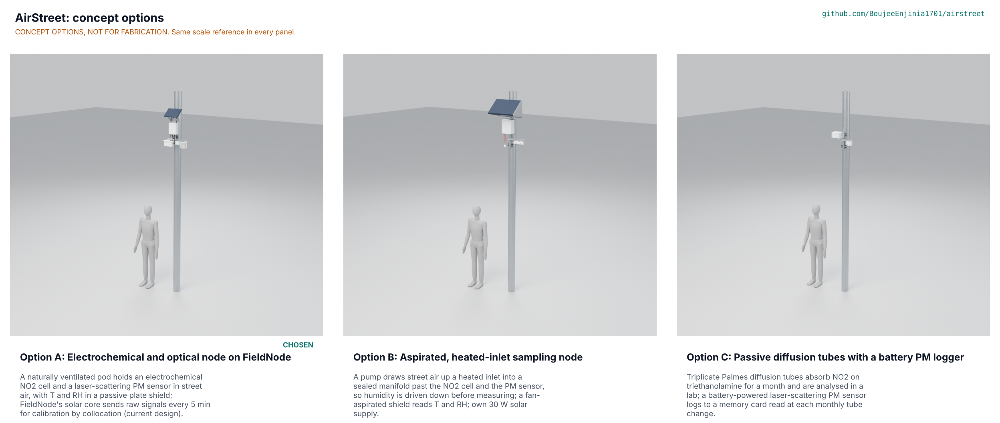

# AirStreet concept options

Result: option A, the current design (an electrochemical NO2 cell and a laser-scattering PM sensor in a naturally ventilated pod on FieldNode's solar core), scores 221 of 260; option C, passive diffusion tubes with a battery PM logger, scores 198 (10.4 % below A); option B, an aspirated, heated-inlet sampling node, scores 188 (14.9 % below A). No option is within 10 % of A, so the recommendation was A, and Amish chose it on 2026-10-30 ("on the calls - i go with your recommendations"; AST-DEC-001 decision 1; AST-DDR-004). The design is not changed: A stays the design of record, as STANDARDS section 21 requires for a repo designed before kit 1.8. The best idea of the runner-up, C, was grafted onto A on 2026-10-30: triplicate diffusion tubes beside some nodes as a cheap, independent check of the annual NO2 means (AST-DEC-001 decision 2; AST-DDR-006). All three options are modelled to detail level D3 in `cad/src/model.py` (Amish, 2026-10-24: "Detail every option"), and the options picture below is rendered from those models by `python .kit/options.py`. Method: STANDARDS section 21.

Figure 1. The three options on the same 140 mm street light pole with a 1.75 m person for scale (Blender Cycles render of the D3 models; CONCEPT OPTIONS, NOT FOR FABRICATION). The picture is rendered on Amish's Mac and is not yet in the repository.

## The options

All three mount on the same pole with the same printed 140° V-saddles and cut-to-length stainless bands on a 40 x 4 mm aluminium rail, put their inlets 3.0 m above the sidewalk, and send no images, audio or personal data. They differ in how the air reaches the sensors and how NO2 is measured.

### Option A: electrochemical and optical node on FieldNode (current design)

A naturally ventilated printed pod hangs from a cross arm under the FieldNode core. Street air enters from below through insect mesh: a laser-scattering particle sensor (SPS30 class) draws its own sample for 60 s every 5 min, and a four-electrode electrochemical NO2 cell with an ozone filter (NO2-B43F class) faces down through the pod floor, read by a potentiostat and a 16-bit ADC. Temperature and humidity are read in an eight-plate passive shield. FieldNode's 6 W panel and 6 Ah LiFePO4 cell power it, and raw signals go out by LoRaWAN every 5 min for calibration by field collocation with a reference station. Risks: humidity above 85 % (PR-001), field NO2 accuracy unproven (PR-002), sensors outside their rated range on hot afternoons and humid nights (flagged, AST-DDR-005 F2; validity for Amish, AST-STM-001 S33). Needs from a partner: a reference station to collocate at, the pole owner's permission, the radio band.

### Option B: aspirated, heated-inlet sampling node

A small diaphragm pump draws about 1 L/min of street air up a 10 mm stainless inlet under a rain cap, through a 2 W heater sleeve that warms the sample a few kelvin so its humidity falls below 80 %, into a machined manifold where the NO2 cell sits in the flow path, and on to the particle sensor in a sealed printed flow box. A 40 mm fan draws air through a double-tube shield for T and RH. With the pump, heater and fan the node needs about 28 Wh a day, so it carries its own 30 W panel, a 12 Ah LiFePO4 pack and a controller in an IP65 enclosure on a back plate. It answers the humidity weakness of A at the cost of power, size and parts. Risks: a heated inlet evaporates part of the nitrate in the particles (AST-STM-001 B4); pump wear; a winter energy deficit in cloudy climates. Needs from a partner: the same as A, plus a site with room for a 0.2 m² panel.

### Option C: passive diffusion tubes with a battery PM logger

Three Palmes diffusion tubes hang open end down under a printed hood on a cross arm that spaces them more than 50 mm from the pole. Each tube holds steel grids coated with triethanolamine at its closed end; NO2 diffuses up the 71 mm tube and is absorbed, and after two to four weeks the tubes are capped and sent to a laboratory, which reports a monthly mean. Beside it an IP65 box holds a particle sensor behind a louvred cowl, a logger board with a memory card and an SHT45, and four D cells, read and changed at each monthly tube change. No radio, no solar. This is how UK local authorities map street NO2 (Defra guidance), so its calibration route is well established, but it gives monthly NO2 only and needs a visit at height every month. Risks: no hourly data; theft or loss of tubes; monthly labour. Needs from a partner: an accredited analysis laboratory and a reference station for bias adjustment.

## First-order numbers

Table 1. Options compared. Option A figures from AST-CAL-001 v0.8 and the BOM; B and C are first-order estimates for comparison only. Parts and fidelity masses from `cad/fidelity.json` (the kit's densities: printed ASA and the circuit boards are taken as HDPE, the FieldNode internals as solids, so these masses are indicative and differ from AST-CAL-001).

| Quantity | Option A | Option B | Option C |
| --- | --- | --- | --- |
| Estimated parts cost (USD) | 306.00 sensor head (priced BOM, with the tube hood); 437.00 with the FieldNode core | About 500 for the whole node (estimate) | About 130 for the hardware (estimate), plus about £8 per tube with analysis (Mapping for Change, 2015 price), 36 tubes a year per site |
| Mass on the pole (kg) | 3.70 (3.86 with FieldNode's sun shield), AST-CAL-001 | About 6 (model) | About 1.5 (model) |
| Frontal area (m²) | 0.144 | About 0.25, the panel dominates (estimate) | About 0.06 (estimate) |
| Parts in the D3 model (with fasteners) | 205 (109 fasteners) | 148 (104 fasteners) | 78 (49 fasteners) |
| Fidelity mass (kg) | 3.3 | 5.9 | 1.5 |
| NO2 data | Hourly, about 4.3 ppb MAE after field calibration (at risk) | Hourly, similar cell, steadier humidity | Monthly mean, about 25 % uncertainty |
| PM2.5 data | Hourly; at risk above 85 % RH | Hourly; dried sample, nitrate loss | Logged every 15 min, read monthly; no shield for RH |
| Energy | 2.33 Wh/day on FieldNode | About 28 Wh/day (estimate), 30 W panel | About 0.5 Wh/day, four D cells a month |
| Service | Pod exchange every 6 months, about 14 min | Pod, filters and pump every 6 months (estimate) | Every month, tubes and cells |
| STEM check | Open: four fixes made, twelve rows plausible, including S33 (validity above 40 degC), decided on 2026-10-30 as flagged hours now | B4 plausible (nitrate loss) | Within known science |

## Scoring

Table 2. Weighted scoring against the user requirements of AST-URS-001 (High weighs 3, Medium 2, Low 1) and the four general criteria; scores 1 to 5.

| Criterion | Source | Weight | A | B | C | Reason |
| --- | --- | --- | --- | --- | --- | --- |
| Fine particles on my street | UR-001 | 3 | 4 | 5 | 3 | B dries the sample; A at risk above 85 % RH; C has no shielded RH for the correction |
| Traffic NO2 on my street | UR-002 | 3 | 4 | 4 | 3 | A and B use the same cell; C gives monthly means only |
| Rank streets with a stated uncertainty | UR-003 | 3 | 4 | 4 | 3 | Hourly data with a stated budget against monthly means at about 25 % |
| Data often enough for street maps | UR-004 | 3 | 5 | 5 | 2 | C reports NO2 monthly and PM only when the card is read |
| A calibration others can check | UR-005 | 3 | 5 | 5 | 5 | Collocation route in A and B; C follows the established bias adjustment of the Defra guidance |
| Raw data to reprocess | UR-006 | 2 | 5 | 5 | 3 | C's NO2 is a laboratory result, not a raw signal |
| Fits existing poles without harm | UR-007 | 3 | 5 | 4 | 5 | B's larger panel and box weigh more on the same clamps |
| Small and light on the pole | UR-008 | 3 | 4 | 1 | 5 | A 3.86 kg against 4.0 kg; B about 6 kg and 0.25 m²; C about 1.5 kg |
| Works outdoors all year | UR-009 | 3 | 3 | 4 | 4 | A's sensors are flagged at the hot and humid ends; B conditions the sample; C's tubes are simple |
| Quick, simple service at height | UR-010 | 2 | 4 | 3 | 2 | A every 6 months; B adds pump and filters; C a visit every month |
| Nothing personal collected | UR-011 | 3 | 5 | 5 | 5 | Levels only in all three |
| Affordable for a district network | UR-012 | 3 | 3 | 2 | 4 | From Table 1; C is cheap to build but each tube costs about £8 to analyse |
| Own power supply | UR-013 | 3 | 5 | 3 | 4 | B needs a 30 W panel and has a winter margin to prove; C swaps cells monthly |
| Open and buildable | UR-014 | 2 | 5 | 3 | 5 | B needs a machined manifold and a pump |
| Safe to install and service | UR-015 | 3 | 4 | 3 | 3 | B is heavier with a heater circuit; C means twelve climbs a year |
| Radio within the rules | UR-016 | 2 | 5 | 5 | 5 | A and B met on paper; C has no radio |
| Cost against the value-engineering target | | 2 | 3 | 2 | 4 | A is USD 21.00 over the USD 285 target for the sensor head |
| Buildable with local skills and tools | | 2 | 4 | 3 | 5 | |
| Safety | | 3 | 4 | 3 | 3 | As UR-015 |
| Maintenance | | 1 | 4 | 2 | 3 | |
| **Weighted total** | | | **221** | **188** | **198** | |

Weighted total = sum of score x weight over the 20 criteria (maximum 260). C is 10.4 % below A and B 14.9 % below A, so no option is within 10 % of the leader.

## Recommendation

Decided by Amish on 2026-10-30 ("on the calls - i go with your recommendations"): carry option A forward as the design of record (AST-DEC-001 decision 1; argued in AST-DDR-004). A is the only option that gives hourly NO2 and PM2.5 inside the pole owner's load and on the lab's shared solar core. C wins on mass, cost to build and simplicity and is a respected method for annual NO2, but it cannot show rush hours or daily patterns (UR-004) and needs a monthly climb. B answers A's humidity weakness but fails the load and area limits by a wide margin.

The runner-up's best idea to graft onto A: triplicate diffusion tubes under a small hood on the same cross arm at a few nodes, changed every two to four weeks by a partner as the Defra guidance asks, as a cheap independent check of the annual NO2 means and of the street transfer bias that limits PR-004 (decided on 2026-10-30, AST-DEC-001 decision 2: at the anchor node and one node in five; in the model since AST-DDR-006). From B, a short heated section at the PM inlet, switched on only above 80 % RH, is the idea to test if PR-001 stays at risk after collocation; it costs power that FieldNode's budget does not have today, so it is a note, not a proposal.
